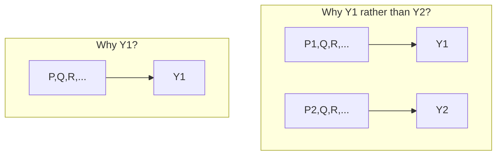
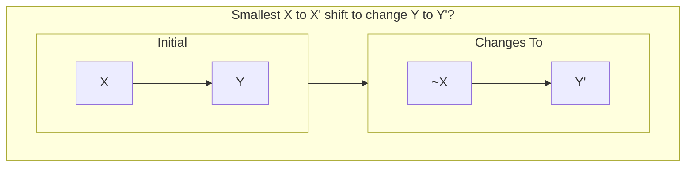
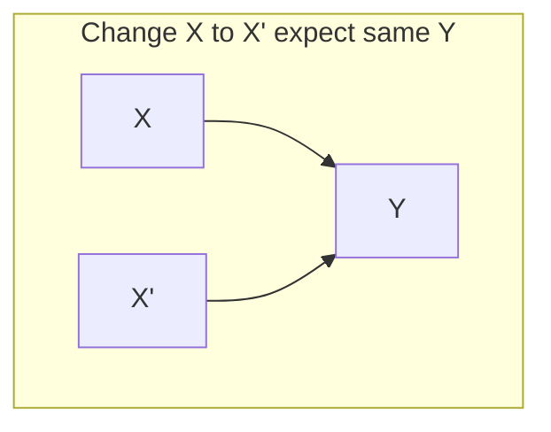

# Explanation

This post is an introduction to explanations.

--------------

## What is an explanation?

<!-- They are more than the presentation of causes, though that is an essential aspect.  -->

In [Studies in The Logic of Explanation][logic_of_expl_hempel], Hempel and Oppenheim (1948) give one definition of _explanation_:

> To explain the phenomena in the world of our experience, to answer the question "why?" rather than only the question "what?"; is one of the foremost objectives of rational enquiry (...)

[How People Explain Action (...)][autonomous_intelligent_systems] (Malle et. al., 2017) highlights a structural aspect of explanations:

> Explanation is arguably a three-value predicate: someone, a communicator, explains something to someone, an audience.

In the book "Why we ask why?" (2026), Tania Lombrozo defines _explanation_ in similar terms to Hempel and Oppenheim's:

> Explanations are responses to actual or implied why- or how-questions that offer understanding about what's being explained.

[Explanation in artificial intelligence: insights from the social sciences][explanations_social] (2019), Miller states that explanation is both a process and a product.[^miller_from_lombrozo]

Inspired by those views, we specify the explanation process as:

1. There is a phenomenon to explain (explanandum),
2. Hypotheses are generated (cognitive process),
3. Hypotheses are communicated to an audience and / or ourselves (social process).

All or some of the above steps may repeat; for example, by refining the explanandum and re-evaluating the hypotheses. Eventually, one hypothesis, the "best explanation", is _selected_ until it is either:

- Contradicted by experience (falsified),
- Superseded by a simpler or more general one,
- Shown to be inconsistent with prior knowledge,
    <!-- - False consequences, -->
    <!-- - Fails to explain other cases, -->
- Other reasons (list is not exhaustive).

And the _product_ view is the resulting or distilled version of this process.

>[!NOTE]
> This definitions are just a starting point, and only cover a subset of instances of what we would call explanations.

### Scientific Explanation

Scientific explanation is a type of explanation, so it inherits all the characteristics mentioned earlier.

What makes it _scientific_ is a complex topic. On the whole, scientific explanations tend to be general and supported by large bodies of knowledge; the hypotheses need to be falsifiable, and the selection process involves rigorous proofs or experimental testing.

This paper on the [duality of predictive models][bajorath] describes what constitutes _scientific understanding_ of a phenomenon (references removed) as:

> (...) if there is an underlying intelligible theory such that scientists can qualitatively comprehend the consequences of this theory without the need for quantitative analysis and exact calculations.

## The Cognitive Process

<!-- The first part of the process of explaining is the cognitive process. -->

This section analyses the generation of explanaory hypotheses, that is, those allegedly leading to the event, object or situation (explanandum) under analysis.

### Alternative Outcomes (Contrastive Questions)

[Miller et. al.][beware_inmates_asylum] state that assigning causes is "_necessary to provide explanations_"[^attribution].

And rather than _complete_ causal chains, humans tend to _select_ or prioritise some causes over others. [Hesslow][causal_selection_problem] classifies some of the selection criteria such as: proximal over distal events, abnormal or unexpected events over expected ones, and so forth. He then states:

> Many of the selection criteria listed in Section 3 can be construed as the result of **choosing different objects of comparison or reference classes**. Let us consider again the fire in the barn, and let us suppose that we have in the back of our minds the picture of a normal barn. (...) the normal barn has not caught fire, it follows that an explanatorily relevant condition for this barn's catching fire must be abnormal. Thus, selection of **abnormal conditions** can be viewed as the result of comparing the explanandum object with a normal object.

And continues:

> (...) the difference between this barn now and this barn yesterday, i.e. we would be selecting a **precipitating** cause [proximal in the list above]. Selection of the **unexpected** may be viewed as the result of explaining the difference between an expected and an actual outcome. (...)

Hesslow synthesises the idea into a general recipe:

> What I want to suggest, then, is that the explanandum should be construed as a relation which involves three things: an _object a_, an _object of comparison b_ and an _explanandum property E_ which a has and b does not have.

Comparison is a way to subtract similarities and focus on the differences, which ideally will be explanatory.

Here is another illustration by Hesslow:

> For instance, if we want to explain why the fly Ml has shorter wings than Nl, then the temperature in which the flies were raised is explanatorily irrelevant, since the temperature was the same in both cases. The mutated gene on the other hand was present in one case and absent in the other. It is, therefore, explanatorily relevant.

However, selecting a useful reference case (or foil), one that isolates the relevant causes, is far from trivial. As [Explaining Explanations in AI][xxai] states:

> However, choosing a relevant set of cases or events against which contrastive explanations are provided is not a straightforward challenge. (...)

The "reference strategy" described above is equivalent to what is called _contrastive questions_ (or contrastive explanations), described by [Miller et. al.][beware_inmates_asylum] as:

> Perhaps the most important result from this work is that explanations are _contrastive_; or more accurately, _why–questions_ are contrastive. That is, _why–questions_ are of the form "_Why P rather than Q?_", where _P_ is the _fact_ that requires explanation, and _Q_ is some _foil_ case that was expected.

In the case of "Why P?" questions there is usually an _implicit_ foil; Miller gives an example of this case:

> (...) "Why did Mr. Jones open the window?" with the response "Because he was hot" is not useful if the implied foil is Mr. Jones turning on the air conditioner, as this explains both the fact and the foil; or if the implied foil was why Ms. Smith, who was sitting closer to the window, did not open it instead, as the cited cause does not refer to a cause of Ms. Smith's lack of action.

We can aggregate these concepts into a diagram:



As a concrete (imaginary) example consider "Y1=It snows" when P=P1 and "Y2=It rains" when P=P2. So we ask: Why did it snow rather than rain? Because P's value was P1 (had it been P2 it would have rained instead).

By cancelling causes leading to both outcomes (or similarities), and also keeping the differences, contrasts simplify explanation generation.

--------------

<details>
<summary>Aside on Counterfactuals (optional section, click to open)</summary>

### The Idea of Counterfactuals

We have considered how foils can help us answer "Why P rather than Q?" by highlighting some explanatory _cause_. Counterfactuals are one way to define causes, so we will briefly describe them.
<!-- or difference leading to the outcome. -->

Counterfactual means "contrary to the facts", a state different to what actually happened, an alternate world. Hence, counterfactuals _aren't restricted to_ causal inference (e.g. ["Counterfactual Explanations"](#alternative-sources-and-outcomes-counterfactual-explanations)).

But counterfactuals _can_ be used to define causes, as we do next.

Consider two events: A and B. Consider also that, had A not happened first, B wouldn't have happened. We conclude that A is the cause of B (via a counterfactual view of causes).

This definition doesn't mean we must know _how_ A leads to B. It is a _cause_ if it solves the counterfactual.

When we answer "Why B rather than C?", the cause (say "X") shouldn't lead to both outcomes. If so, it can't explain why only _one_ of them happened. We want a case where "X" makes "B" likely but not "C".

Up to this point, we have argued that the cognitive process (of an explanation) often involves (and benefits from) using contrastive questions such as: "Why P rather than Q?". Contrastive questions aim to spotlight some event that leads to P but not to Q.

Next, we will continue to explore contrastive explanations but change the question slightly.

</details>

--------------

### Alternative Sources (What if ...?)

As a summary, we have a few related questions (currently at the second one, "What Ifs"):

- **Why-questions** (Relate to Alternative Outcomes) ask for the source that _led to_ the current state (and may use a reference state or contrast); the unknown is the cause (or source).
- **What-if questions** (Alternative Sources) ask for the outcome _after changing_ the initial state; the unknown is the effect (or outcome).
- **Counterfactual Explanations** (Or closest possible world, or Alternative Sources and Outcomes; see next section): asks for the smallest change to X (~X) leading not to Y but to Y'; the unknown is the necessary change in X.

Visually:


### Alternative Sources and Outcomes (Counterfactual Explanations)

[Counterfactual explanations without opening the black box (...)][counterfactual_explanations_gdpr] defines "Counterfactual Explanations" as:

> We define Counterfactual Explanations as statements taking the form: Score p was returned because variables V had values (v1, v2,...) associated with them. If V instead had values (v1', v2',...), and all other variables had remained constant, score p' would have been returned.
>
> While many such explanations are possible, an ideal counterfactual explanation would alter values as little as possible and represent a closest world under which score p' is returned instead of p. The notion of a "closest possible world" is thus implicit in our definition.

So instead of the question "_Why P rather than Q?_" we ask "_What minimal changes (to the inputs) take us from P to P' (or Q)?_".
<!-- But we can't know in advance which metric to use.-->

Another kind of counterfactual seeks for the output to remain the same rather than to change (for fairness purposes), they state:


<!-- ; this could be called "_Shifting-Counterfactual_ Contrastive Explanation". They state: -->

> Kusner et al.58 consider counterfactuals where the subject belongs to a different race or sex, and require that the decision made remain the same under such a counterfactual for it to be considered fair. In contrast, we consider counterfactuals in which the decision differs from its current state.

This one could be called "Alternative Sources Equal Outcome". Often, multiple counterfactual explanations may be preferred, so that the subject can choose the optimal one.



<!-- ### All Diagrams -->
<!---->
<!-- ```mermaid -->
<!-- flowchart TB -->
<!-- subgraph "Why Y rather than Y'?" -->
<!-- A["P1,Q,R,..."]->B["Y"] -->
<!-- C["P2,Q,R,..."]->D["Y'"] -->
<!-- end -->
<!-- subgraph "What if X' rathen than X?" -->
<!-- X->Y -->
<!-- X'["X'"]->Z["?"] -->
<!-- end -->
<!---->
<!-- subgraph "Smallest change in X to change Y to Y'?" -->
<!-- subgraph W[Initial] -->
<!-- direction LR -->
<!-- L["X"]->M["Y"] -->
<!-- end -->
<!-- subgraph Q["Changes To"] -->
<!-- direction LR -->
<!-- L'["~X"]->M'["Y'"] -->
<!-- end -->
<!-- W -> Q -->
<!-- end -->
<!-- ``` -->

### Real and Virtual Causes

"Counterfactual Explanations" explain the behaviour of the model, but not necessarily of the world.

[Counterfactual explanations without opening the black box (...)][counterfactual_explanations_gdpr] is clear about it:

> In any case, our approach does not rely on knowledge of the causal structure of the world, (...)

Whether this approach can help doing causal inference depends on what the model is based off. If there is a causal graph, then it is, if there isn't one (most often) then it is not.

In other words, it seems useful to differentiate between models that mirror the causal structure of the world, versus those that don't.
<!-- At the same time, this means that counterfactual explanations (that I called "alternative sources and outcomes") can be used to assign "virtual causes" rather than real, unless the model represents the real world via a causal graph. -->

<!-- And this is because machine learning models are usually doing correlation, which is very useful for prediction. To do causal inference the model must be representing a causal graph that exists in the real world. -->
<!-- "virtual causes", which are responsible for the output of a model (e.g. when we change the input and changes the output, or not causes when they don't), and real causes, related to virtual or actual causal models of the world. -->

Unless the model embodies a causal graph based on the real world inferring from the model's behaviour a cause in the real world would be incorrect. And even if it does model the causal structure of the world, we still need to test the inference.

The paper on the [duality of models][bajorath] touches on this aspect, and how framing a model within a scientific framework (in particular causal theories), can be useful.

Building causal models with causal variables (based of real world causal graphs) may be preferred for in modelling certain problems, and for explaining and testing them.

### Virtual causes and Object Classification

Another related case here is the classification of objects (physical or abstract), "Why are spiders arthropods rather than insects?" does not involve a real cause, but this framing is quite useful for answering (focusing on the differences).

<!-- Pearl has a "Ladder of Causation" for causal attribution (assigning causes): -->
<!---->
<!-- 1. Association / correlation: can't assign causes, -->
<!-- 2. Interventions: experiments where $X$ is a cause if  $P(Y | do(X_i)) \gt P (Y)$ (other variables remain constant) i.e. $X$ increases the probability of the outcome; also observations in double blind, randomised controlled trials (RCTs), -->
<!-- 3. Cause-finding Counterfactuals: require that we have a causal graph. -->

## Social Process (Communication)

We have gone through the _cognitive process_ and how contrastive questions (and related questions) can aid the generation and selection of a hypotheses or causes (real or virtual).

The second process is that of communication. This isn't just the _transfer of knowledge_; in the best cases, it involves an exchange between the participants (explainer and explainee), as in a e.g. dialogue.

The communication can be aided by the [gricean maxims][gricean_maxims]: rules of _effective_ communication.

- **Informative** (Quantity): right amount of context and details,
- **Truthful** (Quality, or Fidelity): the explanation should be true,
- **Relevance** (Relation): avoid presumed-known or superfluous details, focus on what provides insight,
    - One example given earlier is to focus on unexpected events, whilst ignoring what is presumed to be known by the listener.
- **Manner** (clarity): express it in elegant terms.

In some cases, humans also tend to prefer concrete over abstract explanations, so "concreteness" could be added to the list.

_Relevance_ is primarily related to the _causal selection problem_ in relation to an audience, as [Malle et. al., state][autonomous_intelligent_systems]:

> How do people solve this problem? They determine what exact question the audience is interested in (McClure and Hilton 1998); they take into account what their audience member already knows (Slugoski et al. 1993); and they offer elements of explanations that build bridges between presumed knowledge and novel information (Korman and Malle 2016). In short, they offer explanations that generate coherence in a knowledge structure of old and new information (Thagard 1989).

_Contrastive explanations_ can also take care of many of these aspects automatically, by selecting a contrast that is relevant or understood by the audience.

--------------

<details>
<summary>Sources</summary>

1. [Studies in the logic of explanation][logic_of_expl_hempel] (1948), Their _logically deductive_ model, and the related _covariation_ model (Kelley, 1967) isn't how human explanations are considered in social and cognitive sciences any more. However, these are important historical background.
1. [Explanations, Predictions and Laws][scriven] (1948),
1. [On the mechanization of abductive logic][abductive_logic] (1973). The first page is quite interesting.
1. [The Problem of Causal Selection][causal_selection_problem] (1988) fascinating and easy-to-read article.
1. [Explainable AI: Beware of Inmates Running the Asylum Or: How I Learnt to Stop Worrying and Love the Social and Behavioural Sciences][beware_inmates_asylum] (2017): Section 1 describes what the wrong approach is: building explanation models with an idea of explanation that only applies to experts. Section 2 surveys papers and notes almost none uses insights from social science of explanation to build their XAI algorithms, and even less evaluate them on humans. Section 3 is the most useful, and describes **which insights from social sciences could be used** (and points to research).
   - And an extension of that work ["Explanation in artificial intelligence: insights from the social sciences"][explanations_social] (2019, 38 pages).
   - Once the why-cause is found (diagnosis), it may be communicated, making rules of conversation relevant: [Gricean Maxims of Communication][gricean_maxims] (blog-post), or [Wikipedia's][wikipedia_gricean].
   - The definition of explanation extends previous work by Lombrozo on [The structure and function of explanations][lombrozo] (2006).
1. [How People Explain Action (and Autonomous Intelligent Systems Should Too)][autonomous_intelligent_systems] (2017). Argues that Agents will necessarily have initiative, planning, decision making and people will regard them as intentional agents. They will explain them (and expect the system to do so) as if it were a human.
1. [Explaining Explanations in AI][xxai] (2019), a fantastic paper, from the perspective of "explanation sciences" (philosophy, cognitive sciences, social sciences). Defines terms clearly (XAI, Explanation in XAI, Interpretability/Explainability), distinguishes the main areas (transparency and post-hoc interpretability), and names important post-hoc methods.
1. [Counterfactual explanations without opening the black box: Automated decisions and the GDPR][counterfactual_explanations_gdpr] (2019) defines counterfactual explanations pretty clearly.
1. Blog Posts: [What is Explainable AI?][what_is_xai] (2022) and from [IBM][xai_ibm].
1. [Good Explanations in Explainable Artificial Intelligence (XAI): Evidence from Human Explanatory Reasoning][byrne_human_explanations] (2023). This paper discusses certain aspects of human explanations and understanding. For example: the illusion of understanding, thinking fast (intuitive, heuristic) and slow (deliberate, methodical), and explanatory stances. It also discusses counterfactual and causal explanations.

</details>

<!-- Also, a very interesting experiment in terms of explainability was <https://distill.pub>. -->

[abductive_logic]:https://www.ijcai.org/Proceedings/73/Papers/017.pdf

[autonomous_intelligent_systems]: https://aaai.org/papers/16009-16009-how-people-explain-action-and-autonomous-intelligent-systems-should-too/

[bajorath]: https://www.cell.com/cell-reports-physical-science/fulltext/S2666-3864(25)00115-8

[beware_inmates_asylum]: http://arxiv.org/abs/1712.00547

[byrne_human_explanations]: https://doi.org/10.24963/ijcai.2023/733

[causal_selection_problem]: https://www.researchgate.net/publication/232592695_The_problem_of_causal_selection

[counterfactual_explanations_gdpr]: https://heinonline.org/hol-cgi-bin/get_pdf.cgi?handle=hein.journals/hjlt31&section=29c

[explanations_social]: https://doi.org/10.1016/j.artint.2018.07.007

[gricean_maxims]: https://effectiviology.com/principles-of-effective-communication/

[logic_of_expl_hempel]: https://fitelson.org/woodward/hempel_oppenheim.pdf

[lombrozo]: https://fitelson.org/few/few_08/lombrozo_reading.pdf

<!-- [mu]: https://www.cell.com/trends/cognitive-sciences/fulltext/S1364-6613(26)00077-X -->

[scriven]: https://fitelson.org/woodward/scriven_epl.pdf

<!-- [XAI for whom]: http://arxiv.org/abs/2106.05568 -->
[wikipedia_gricean]: https://en.wikipedia.org/wiki/Cooperative_principle

[what_is_xai]: https://www.sei.cmu.edu/blog/what-is-explainable-ai/

[xai_ibm]: https://www.sei.cmu.edu/blog/what-is-explainable-ai/

[xxai]: https://dl.acm.org/doi/10.1145/3287560.3287574

[^miller_from_lombrozo]: From Lombrozo's work.
[^attribution]: Attribution theory is about how people assign causes to events.

<!-- -->
<!---->
<!-- > In short, contrastive theories argue that causal explanations inevitably involve appeal to a counterfactual case, be it a cause or event, which did not occur. A canonical example is provided by Lipton Lipton (1990): "To explain why P rather than Q, we must cite a causal difference between P and not-Q, consisting of a cause of P and the absence of a corresponding event in the history of not-Q". -->

<!-- Also, not all causal explanations involve counterfactuals.[^funny] -->

<!-- _Why-questions_ asking for a cause (causal explanation) can be answered via causal-counterfactual explanations. -->
<!-- Counterfactual explanations don't use a hypothesised causal graph, so they aren't causal explanations (don't do causal attribution). In their own words: -->
