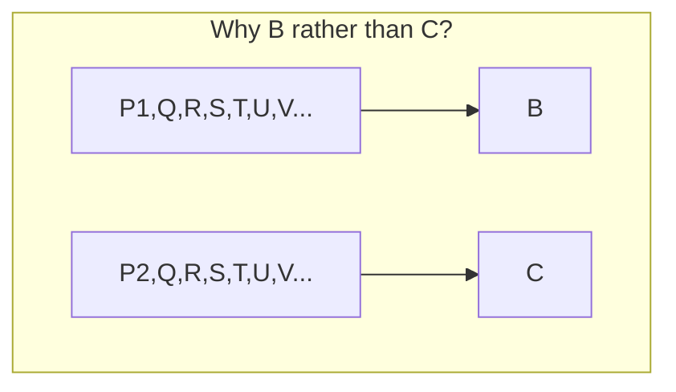
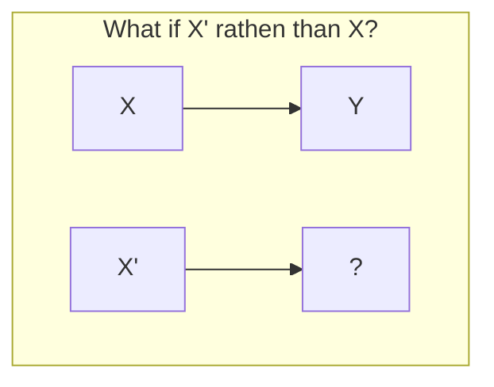
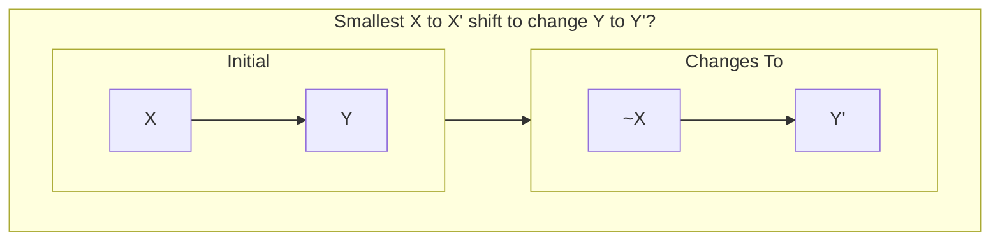
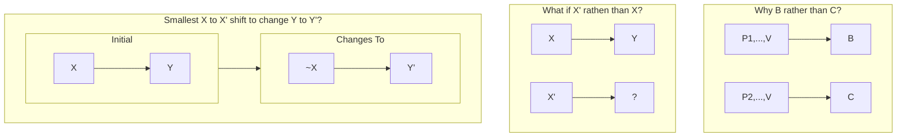

# Explanation

This post is an introduction to explanations.

<!-- In some papers _explainability_ and _interpretability_ are distinguished; in other papers, they are not. In this post, they are not, but _explainability_ is preferred. -->

--------------

## What is an explanation?

<!-- They are more than the presentation of causes, though that is an essential aspect.  -->

A concise definition of an explanation was given in [Studies in The Logic of Explanation][logic_of_expl_hempel] (Hempel and Oppenheim, 1948):

> To explain the phenomena in the world of our experience, to answer the question "why?" rather than only the question "what?"; is one of the foremost objectives of rational enquiry (...)

The paper [How People Explain Action (and Autonomous Intelligent Systems Should Too)][autonomous_intelligent_systems] (Malle et. al., 2017) highlights a structural aspect of explanations:

> Explanation is arguably a three-value predicate: someone, a communicator, explains something to someone, an audience.
<!-- (...) The success of an explanation therefore depends on several critical audience factors—assumptions, knowledge, and interests that an audience has when decoding the explanation. -->

<!-- But what is "explains"? -->

<!-- [Explaining Explanations in AI][xxai] (Wachter et. al., 2019) emphasise explaining complex models: -->
<!---->
<!-- > (...) "explanation" refers to numerous ways of exchanging information about a phenomenon, in this case the functionality of a model or the rationale and criteria for a decision, to different stakeholders (Lipton, 2016; Miller, 2017). -->

In the book "Why we ask why?" (2026), Tania Lombrozo defines _explanation_ in similar terms to Hempel and Oppenheim's:

> Explanations are responses to actual or implied why- or how-questions that offer understanding about what's being explained.

[Explanation in artificial intelligence: insights from the social sciences][explanations_social] (Miller, 2019; citing Lombrozo) states that explanation is both a process (see following list) and a product (the result).

These ideas can be combined as below:

- _Someone explains something (the explanandum) to someone_, in two steps:
  1. **Cognitive Process**: explanatory hypotheses are generated (aiming for _understanding_),
  2. **Social Process**: the hypotheses are communicated to an audience and / or ourselves.

All or some of the steps may repeat; for example, by refining the explanandum and re-evaluating the hypotheses. Eventually, one hypothesis, the "best explanation", is _selected_ until it is either:

- Contradicted by experience (falsified),
- Superseded by a simpler or more general one,
- Shown to be inconsistent with prior knowledge,
    <!-- - False consequences, -->
    <!-- - Fails to explain other cases, -->
- Other reasons (list is not exhaustive).

<!-- The process of explaining can expose a lack (or illusion) of understanding; it can also show and improve understanding. -->

<!-- So the _cognitive process_ involves the generation of hypotheses, theories and reasons, which in turn reflect our _understanding_ about how something works, though this is just one view of understanding[^mu_post]. -->

>[!NOTE]
> This definitions are just a starting point, and only cover a subset of instances of what we'd call explanations.
<!-- As Lombrozo notes in her book, this perspective on what explanations are leaves out certain cases such as "_Can you explain me the meaning of this word?_" This is where the "why or how" in Lombrozo's definition matters. The aspects we will focus here are closer to explanation of mechanisms and everyday events and may or not be helpful for other kinds of questions and situations. -->

### Scientific Explanation

Scientific explanation is a type of explanation, so it inherits all the characteristics mentioned earlier.

What makes it _scientific_ is a complex topic. On the whole, scientific explanations tend to be general and supported by large bodies of knowledge; the hypotheses need to be falsifiable, and the selection process involves rigorous proofs or experimental testing.

The paper "[From scientific theory to duality of predictive artificial intelligence models][bajorath]" describes what constitutes _scientific understanding_ of a phenomenon (references removed) as:

> (...) if there is an underlying intelligible theory such that scientists can qualitatively comprehend the consequences of this theory without the need for quantitative analysis and exact calculations.

<!-- -------------------- -->
<!---->
<!-- We now turn to the _cognitive_ and _social_ processes that make an explanation. -->
<!---->
<!-- -------------------- -->
<!-- This "qualitative comprehension" seems (intuitively at least) to be related to causality (scientific?), but maybe also to familiarity with a reference case (everyday?). -->

<!-- In the case of _AI-models_ (either approximations or the original ones) we may also require to know its assumptions (e.g. is it causal or correlative?), domain of applicability, accuracy and other model characteristics. -->

## The Cognitive Process

<!-- The first part of the process of explaining is the cognitive process. -->

The central aspect of this process is the generation of hypotheses that could lead to the event, object or situation (explanandum) under analysis.

<!-- In the following sections, two strategies used in the cognitive process referred to as "Contrastive" and "Counterfactual" explanations. But as an experiment, here those are called "Alternative Outcomes" and "Alternative Sources", respectively, to clarify not only what they are, but also emphasise the difference between them. -->

<!-- (I considered "Alternative Outputs" and "Alternative Inputs" but these would point to simulations only, so I am avoiding them. However, they may be useful in a different context.) -->

### Alternative Outcomes (Contrastive Questions)

Causal attribution seems to be essential to answer _why-questions_ [Miller et. al.][beware_inmates_asylum] state that assigning causes is "_necessary to provide explanations_"[^attribution].

But rather than complete causal chains, humans tend to select some causes over others. For example, [Hesslow][causal_selection_problem] considers that humans favour proximal over distal events (in the causal chain of events); abnormal or unexpected events; controllable events, deviation from theoretical ideals, model, predictive power, responsibility, and so forth.

The same effect (selecting some causes) is achieved by using a reference case (or foil). Hesslow states:

> Many of the selection criteria listed in Section 3 can be construed as the result of **choosing different objects of comparison or reference classes**. Let us consider again the fire in the barn, and let us suppose that we have in the back of our minds the picture of a normal barn. (...) the normal barn has not caught fire, it follows that an explanatorily relevant condition for this barn's catching fire must be abnormal. Thus, selection of **abnormal conditions** can be viewed as the result of comparing the explanandum object with a normal object.

> (...) the difference between this barn now and this barn yesterday, i.e. we would be selecting a **precipitating** cause [proximal in the list above]. Selection of the **unexpected** may be viewed as the result of explaining the difference between an expected and an actual outcome. Selection according to **responsibility** follows from a comparison between actual and morally ideal behaviour. Selection of conditions which cause a **deviation from a theoretical ideal** involves a comparison between an actual and a theoretically ideal situation, and so on (cf. Hesslow, 1983).

And then he describes a general recipe:

> What I want to suggest, then, is that the explanandum should be construed as a relation which involves three things: an _object a_, an _object of comparison b_ and an _explanandum property E_ which a has and b does not have.

In other words, by focusing on differences between the actual case and the reference, we reduce the causes, variables, or characteristics to consider.

Here is yet another illustration by Hesslow, of how a foil can narrow down possible causes:

> For instance, if we want to explain why the fly Ml has shorter wings than Nl, then the temperature in which the flies were raised is explanatorily irrelevant, since the temperature was the same in both cases. The mutated gene on the other hand was present in one case and absent in the other. It is, therefore, explanatorily relevant.

However, selecting a useful reference case (or foil), one that isolates the relevant causes, is far from trivial. As [Explaining Explanations in AI][xxai] states:

> However, choosing a relevant set of cases or events against which contrastive explanations are provided is not a straightforward challenge. (...)

<!-- The last sentence is related to the social process of explaining described later on in this post (see Gricean Maxims, _relevance_). -->

The "reference strategy" described above is equivalent to what is called _contrastive questions_ (or contrastive explanations), as [Miller et al.,][beware_inmates_asylum] put it:

> Perhaps the most important result from this work is that explanations are _contrastive_; or more accurately, _why–questions_ are contrastive. That is, _why–questions_ are of the form "_Why P rather than Q?_", where _P_ is the _fact_ that requires explanation, and _Q_ is some _foil_ case that was expected.

Even "Why P?" questions usually have an _implicit_ foil. Foils can make answering questions easier, by focusing on the differences between the two cases (and their explanatory role).

Miller et. al. do include an example of _implicit_ foils in why-questions:

> (...) "Why did Mr. Jones open the window?" with the response "Because he was hot" is not useful if the implied foil is Mr. Jones turning on the air conditioner, as this explains both the fact and the foil; or if the implied foil was why Ms. Smith, who was sitting closer to the window, did not open it instead, as the cited cause does not refer to a cause of Ms. Smith's lack of action.

We can consider some of these concepts in a simple diagram:

Consider the diagram above with a concrete example of an imaginary phenomenon of "It snows" when $P=P_1$ and "It rains" when $P=P_2$ and all the rest are the same. So we ask: Why did it snow rather than rain? Because P's value was $P_1$.

The aspect I want to highlight is that all the other variables are the same, so we didn't have to think about them; this is why contrasts are useful.

<!-- The _foil_ focuses the explanation on "What leads to P and not to Q". Similarly it ignores what leads to both. This is usually easier to explain than the standalone fact P. -->
<!-- , and can also reduce confusion. -->

<!-- Let's digress briefly to explore how all this relates to causes and causal inference. -->

### The Idea of a Counterfactual

We have considered that answering "Why P?" or "Why P rather than Q?" involves finding _a cause_. Counterfactuals are one way to define causes, so we will briefly describe them.

Counterfactual means "contrary to the facts"; that is, a hypothetical or imaginary world other than what actually happened. Counterfactuals can be used to define causes as is done below:

>[!NOTE]
> Defining _Cause_ via Counterfactuals
> Assume that an event B happened. Then, if B couldn't have happen without A, we can say that A is _a cause_ of B or that "B wouldn't have happened had A not happened".

This definition doesn't mean we must know the entire mechanism that lead to an outcome. It is a _cause_ if it solves the counterfactual.

A cause "X" shouldn't lead to both P and Q. If so, it can't explain why only _one_ of them happened. So we want a case where "X" makes "P" likely but not "Q".

In this case, we are using the counterfactual definition of a cause: Had X not happened, P wouldn't have happened and Q could have happened. The contrast helps us reduce the number of causes to consider.

Later on Counterfactual Explanations are analysed, that definition is slightly different to this more general one, and it is useful to know both.

--------------------------

So far, the idea is that to use "Why P rather than Q?" to help reduce complexity and infer a cause; that is, an event that leads to P but not to Q.

Next, we will continue to explore contrastive explanations but change the question slightly.

--------------------------

### Alternative Sources (What if ...?)

- Why-questions ask which previous state (cause) led to the current one;
- What-if questions ask about the future state _after changing_ the initial state.

Here is each of them, visually:

There are other interesting questions we can ask with these diagrams such as which smallest changes on X (that is, X') change Y to our desired outcome (Y'), or what is the largest change on X that keeps Y unchanged.

We could also represent how many causes ($X_1$, $X_2$, $\ldots$) are shadowed by a reference case, simplifying the number of causes to consider (for example leaving only $X_1$).

### Alternative Sources and Outcomes (Counterfactual Explanations)

Instead of the question "_Why P rather than Q?_" we can ask "_What minimal changes (to the inputs) take us from P to Q (or P')?_". This close to what [Counterfactual explanations without opening the black box (...)][counterfactual_explanations_gdpr] asks:

> We define Counterfactual Explanations as statements taking the form: Score p was returned because variables V had values (v1, v2,...) associated with them. If V instead had values (v1', v2',...), and all other variables had remained constant, score p' would have been returned.
>
> While many such explanations are possible, an ideal counterfactual explanation would alter values as little as possible and represent a closest world under which score p' is returned instead of p. The notion of a "closest possible world" is thus implicit in our definition.

A more descriptive name would be something like "Shifting _Counterfactual-Contrastive_ Explanations" since we are "shifting" the input state with the goal of "shifting" the output state (to the contrast).
<!-- But in fact, we can't know in advance which metric to use.-->

Another kind of counterfactual seeks for the output to remain the same rather than to change (for fairness purposes); this could be called "_Shifting-Counterfactual_ Contrastive Explanation". They state:

> Kusner et al.58 consider counterfactuals where the subject belongs to a different race or sex, and require that the decision made remain the same under such a counterfactual for it to be considered fair. In contrast, we consider counterfactuals in which the decision differs from its current state.

Often, multiple counterfactual explanations may be preferred, so that the subject can choose the optimal one.

### Comparative Diagram

## Causal Explanations in AI

Machine Learning Models are often doing correlation, so the assignment of causes may lead us astray, since it does not correspond to a real structure in the world (for that case, it should be based on a causal graph).

Building models where causal variables and causal graphs are preferred is of interest for certain modelling problems.

<!-- -->
<!---->
<!-- > In short, contrastive theories argue that causal explanations inevitably involve appeal to a counterfactual case, be it a cause or event, which did not occur. A canonical example is provided by Lipton Lipton (1990): "To explain why P rather than Q, we must cite a causal difference between P and not-Q, consisting of a cause of P and the absence of a corresponding event in the history of not-Q". -->

<!-- Also, not all causal explanations involve counterfactuals.[^funny] -->

<!-- _Why-questions_ asking for a cause (causal explanation) can be answered via causal-counterfactual explanations. -->
<!-- Counterfactual explanations don't use a hypothesised causal graph, so they aren't causal explanations (don't do causal attribution). In their own words: -->

[Explaining Explanations in AI][xxai] is clear about it:

> In any case, our approach does not rely on knowledge of the causal structure of the world, (...)

Pearl has a "Ladder of Causation" for causal attribution (assigning causes):

1. Association / correlation: can't assign causes,
2. Interventions: experiments where $X$ is a cause if  $P(Y | do(X_i)) \gt P (Y)$ (other variables remain constant) i.e. $X$ increases the probability of the outcome; also observations in double blind, randomised controlled trials (RCTs),
3. Cause-finding Counterfactuals: require that we have a causal graph.

## Social Process (Communication)

We have gone through the _cognitive process_ and how contrastive questions can aid the generation and selection of a hypothesis or a cause.

The second process is that of communication. This isn't just the _transfer of knowledge_; in the best cases, it involves an exchange between the participants (explainer and explainee), as in a e.g. dialogue.

The communication can be aided by the [gricean maxims][gricean_maxims]: rules of _effective_ communication.

- **Informative** (Quantity): right amount of context and details,
- **Truthful** (Quality, or Fidelity): the explanation should be true,
- **Relevance** (Relation): avoid presumed-known or superfluous details, focus on what provides insight,
    - One example given earlier is to focus on unexpected events, whilst ignoring what is presumed to be known by the listener.
- **Manner** (clarity): express it in elegant terms.

In some cases, humans also tend to prefer concrete over abstract explanations, so "concreteness" could be added to the list.

_Relevance_ is primarily related to the _causal selection problem_ in relation to an audience, as [Malle et. al., state][autonomous_intelligent_systems]:

> How do people solve this problem? They determine what exact question the audience is interested in (McClure and Hilton 1998); they take into account what their audience member already knows (Slugoski et al. 1993); and they offer elements of explanations that build bridges between presumed knowledge and novel information (Korman and Malle 2016). In short, they offer explanations that generate coherence in a knowledge structure of old and new information (Thagard 1989).

_Contrastive explanations_ can also take care of many of these aspects automatically, by selecting a contrast that is relevant or understood by the audience.

--------------

Sources

1. [Studies in the logic of explanation][logic_of_expl_hempel] (1948), Their _logically deductive_ model, and the related _covariation_ model (Kelley, 1967) isn't how human explanations are considered in social and cognitive sciences any more. However, these are important historical background.
1. [Explanations, Predictions and Laws][scriven] (1948),
1. [On the mechanization of abductive logic][abductive_logic] (1973). The first page is quite interesting.
1. [The Problem of Causal Selection][causal_selection_problem] (1988) fascinating and easy-to-read article.
1. [Explainable AI: Beware of Inmates Running the Asylum Or: How I Learnt to Stop Worrying and Love the Social and Behavioural Sciences][beware_inmates_asylum] (2017): Section 1 describes what the wrong approach is: building explanation models with an idea of explanation that only applies to experts. Section 2 surveys papers and notes almost none uses insights from social science of explanation to build their XAI algorithms, and even less evaluate them on humans. Section 3 is the most useful, and describes **which insights from social sciences could be used** (and points to research).
   - And an extension of that work ["Explanation in artificial intelligence: insights from the social sciences"][explanations_social] (2019, 38 pages).
   - Once the why-cause is found (diagnosis), it may be communicated, making rules of conversation relevant: [Gricean Maxims of Communication][gricean_maxims] (blog-post), or [Wikipedia's][wikipedia_gricean].
   - The definition of explanation extends previous work by Lombrozo on [The structure and function of explanations][lombrozo] (2006).
1. [How People Explain Action (and Autonomous Intelligent Systems Should Too)][autonomous_intelligent_systems] (2017). Argues that Agents will necessarily have initiative, planning, decision making and people will regard them as intentional agents. They will explain them (and expect the system to do so) as if it were a human.
1. [Explaining Explanations in AI][xxai] (2019), a fantastic paper, from the perspective of "explanation sciences" (philosophy, cognitive sciences, social sciences). Defines terms clearly (XAI, Explanation in XAI, Interpretability/Explainability), distinguishes the main areas (transparency and post-hoc interpretability), and names important post-hoc methods.
1. [Counterfactual explanations without opening the black box: Automated decisions and the GDPR][counterfactual_explanations_gdpr] (2019) defines counterfactual explanations pretty clearly.
1. Blog Posts: [What is Explainable AI?][what_is_xai] (2022) and from [IBM][xai_ibm].
1. [Good Explanations in Explainable Artificial Intelligence (XAI): Evidence from Human Explanatory Reasoning][byrne_human_explanations] (2023). This paper discusses certain aspects of human explanations and understanding. For example: the illusion of understanding, thinking fast (intuitive, heuristic) and slow (deliberate, methodical), and explanatory stances. It also discusses counterfactual and causal explanations.

<!-- Also, a very interesting experiment in terms of explainability was <https://distill.pub>. -->

[abductive_logic]:https://www.ijcai.org/Proceedings/73/Papers/017.pdf

[autonomous_intelligent_systems]: https://aaai.org/papers/16009-16009-how-people-explain-action-and-autonomous-intelligent-systems-should-too/

[bajorath]: https://www.cell.com/cell-reports-physical-science/fulltext/S2666-3864(25)00115-8

[beware_inmates_asylum]: http://arxiv.org/abs/1712.00547

[byrne_human_explanations]: https://doi.org/10.24963/ijcai.2023/733

[causal_selection_problem]: https://www.researchgate.net/publication/232592695_The_problem_of_causal_selection

[counterfactual_explanations_gdpr]: https://heinonline.org/hol-cgi-bin/get_pdf.cgi?handle=hein.journals/hjlt31&section=29c

[explanations_social]: https://doi.org/10.1016/j.artint.2018.07.007

[gricean_maxims]: https://effectiviology.com/principles-of-effective-communication/

[logic_of_expl_hempel]: https://fitelson.org/woodward/hempel_oppenheim.pdf

[lombrozo]: https://fitelson.org/few/few_08/lombrozo_reading.pdf

[mu]: https://www.cell.com/trends/cognitive-sciences/fulltext/S1364-6613(26)00077-X

[scriven]: https://fitelson.org/woodward/scriven_epl.pdf

<!-- [XAI for whom]: http://arxiv.org/abs/2106.05568 -->
[wikipedia_gricean]: https://en.wikipedia.org/wiki/Cooperative_principle

[what_is_xai]: https://www.sei.cmu.edu/blog/what-is-explainable-ai/

[xai_ibm]: https://www.sei.cmu.edu/blog/what-is-explainable-ai/

[xxai]: https://dl.acm.org/doi/10.1145/3287560.3287574

<!-- [^mu_post]: A recent paper by [Lombrozo et. al.][mu] (2026) proposes a pluralist approach to _machine understanding_, and is discussed in [this post](../systems_that_learn/machine_understanding_2.md). -->

[^attribution]: Attribution theory is about how people assign causes to events.
<!-- What is considered _cause_ depends on the explanatory stance (intentional, mechanical, design and so forth). -->
<!-- Miller et. al. distinguish _social_ from _general_ causal attribution. For the _general_ case, they state (references removed): -->
<!---->
<!-- > Research on how people connect causes shows that they do so by undertaking a mental simulation of _what would have happened_ had some other event turned out differently. -->
<!---->
<!-- Social attribution uses beliefs, desires, intents and traits (of people) as causes. -->
<!-- [^funny]: As [Counterfactuals Explanations Without Opening The Black Box][counterfactual_explanations_gdpr] states: "For example, S could believe that a person is inherently more trustworthy (p) because they are a Capricorn (q)." -->

<!-- ### Counterfactuals And Contrasts -->
<!---->
<!-- The difference between a counterfactual and a contrast seems to be that the former (in the context of causal inference) refer to the initial states (or causes); instead, contrasts refer to end-states (the hypothetical end state). -->
<!---->
<!-- We won't put much effort distinguishing these two concepts, but my sense is that they are the same under the hood, and the context indicates when one or the other is used. -->
<!---->
<!-- Answering a contrastive question implies finding a cause or a difference that leads to P but not to Q. -->
<!-- Counterfactuals usually appear in causal explanations. But not all causal explanations require counterfactuals (this is rung 3 of Judea Pearl's _Ladder of Causation_) -->
<!---->
<!-- For _scientific_ explanation, this is more rigorous and there are also other mechanisms (e.g. Pearl's Ladder of Causation). -->

<!-- However, this isn't entirely correct or complete: we don't only explain by assigning _causes_ in a rigorous way, but we use that form "a cause" for things we know are probably just correlated, but can't quite point at a causal mechanism. -->

<!-- If we have a causal model, we attribute as "cause" of an output, a certain input or feature value; but in that case, it's not the cause for the real world event but for the model's output. Whether it accurately models the real world or not, is a different question. -->

<!-- > [!NOTE] -->
<!-- > (Not sure of this...) -->
<!-- > This is also how we can define a counterfactual question, so at a rough level contrastive and counterfactual questions (and explanations) are the same. -->
