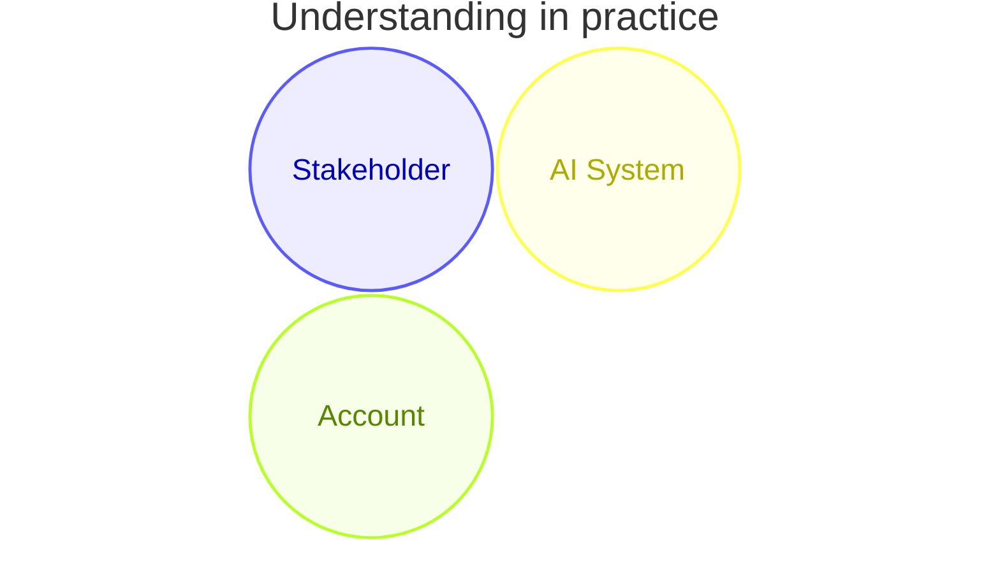

# Accounts of Understanding

On the one hand we have the Strong AI advocates which rely on the Turing test and overt behaviour as a test for thinking and understanding.

On the other hand Searle claims that a machine doing only symbol manipulation won't learn meanings and consequently won't think nor understand. In fact the former method has many other objections and short-comings (as seen in [Machine Understanding](./machine_understanding_1.md))

In practice what we see researchers doing is:

- Carrying out tests and performance benchmarks that test for out of distribution generalisation (or memorisation), transfer learning and so forth;
- Inspecting internal structures (say general ones, algorithms).

A question I find interesting is, closer to Searle's Weak AI ideas:_In the case of learning machines, what kind of programs do / can they give rise to?_

Are they more like look-up tables? Or local rules and heuristics? Or maybe general algorithms? A mixture of all these? Or what are they?

## Machine Understanding Revisited

In the paper ["Machine Understanding"][mu] (2026), Lombrozo et. al. consider _understanding_ as defined for a system _S_ and a task _T_ e.g. "_Do LLMs (S) understand language (T)?_".

They suggest four _accounts_ (or views) of a system's understanding of a task T (two of these are "optional") and _a framework_ to specify _S_ which we won't discuss here.

A key idea in the paper is that _evidence of understanding_ presupposes a particular view of _what understanding is_. An example contextualises this idea:

> We can now consider a more encompassing example. Imagine four (hypothetical) scientists debating whether a given AI system understands anxiety. Dr. M's evidence comes from an analysis of internal representations: a decoding technique has revealed intermediate layers that correspond to key features of anxiety. Dr. A's evidence comes from performance: the system shows excellent performance on key benchmarks. Dr. E's evidence comes from the system's history: its training and interactions in the world. And Dr. P's evidence comes from phenomenology – an account of subjective experience and how the system does (or doesn’t) experience anxiety. (...) if that [the account of understanding] isn't made explicit and introduced into the debate, these scientists will simply talk past one another.
>
> (...)
>
> Taken together, this categorization of the different accounts of understanding offers a potential antidote to a major limitation in current AI evaluation practices: over-reliance on singular or aggregate performance metrics (153; 154; 155).

They also state the following hypothetical example (informally shortened):

> When law students take the bar exam (...) the scores plausibly reflect not only relevant content knowledge, but also relevant experiences and abilities (a mix of model-, ability, and etiologybased considerations). GPT-4 can now score within the top 10% on the bar exam (156), and could perform better soon. But this will not reflect any real-world legal experience, and it might not reflect the generalization ability that the test assesses in humans. Does it possess legal understanding?
>
> (...)
>
> Making an inference from some source of evidence (bar exam performance) to a claim about understanding requires some account of understanding. When that inferential step is spelled out, we can better assess whether it is justified.

A very interesting idea, not always clear in research articles, is that the goals of stake holders may hint to the kind of requirements we should aim for (e.g. account of understanding):

> Which approach to understanding is most useful will depend on the goals of stakeholders and of a given AI system (see Table 1), and which account is adopted can have implications for whether machine understanding is a goal we ought to pursue.

Let's expand on two of the _accounts_:

1. _Model-based_:
  > The basic intuition behind model-based accounts is that understanding is a matter of what a system has "inside" – whether that's particular representations, algorithms, or other internal properties.
  >
  > (...)
  > A challenge for model-based accounts is defining which internal properties constitute understanding.

  This view accounts for MULT understading more than LOOK-UP due to the structure (considers the relationship between multiplicands).

  Decoding layers, which is mentioned a few times in the paper, or computing saliency maps and feature importances are post hoc XAI methods. Decoding a layers may be considered a mechanistic interpretability method, depending on how it is done.

  Other areas are: the design of interpretable and or causal models.

2. _Ability-based_
  > On ability-based accounts, a system's understanding is constituted by its performance or range of behaviors, rather than the internal features that give rise to them.

  They argue that benchmarks are how researchers try to answer the question of performance. But then, there is the question for general ability and where there may be the need to "look inside".

We have partly considered these two earlier as _internal representations_ and _overt behaviour_ (Turing test), respectively.

The paper includes _etiology_ and _phenomenology_ based add-ons for the two _accounts_ given above; they are quite interesting. The former (etiology based) is related to the training process; models trained on specific datasets or ways may in principle be unable to develop certain structures, despite any claims for them. The latter (phenomenology-based) is related to subjective experience. We won't discuss them further in this overview.

An interesting aspects of the paper is the use of a story or hypothetical to frame and illustrate the methods and accounts, such as Dr. Benchmark and Dr. Decode.

Each account suggests ways to test for understanding under that account ($U_x$). But it may also add evidence of understanding in general ($U$). They state (bold is mine):

> Having offered a landscape for possible views about understanding, it might seem attractive to develop benchmarks corresponding to each. Unfortunately, doing so would miss the point: benchmarks will reflect **performance** that could **only constitute understanding on an ability-based account**. On model-based accounts, benchmarks can only offer indirect evidence (for internal properties).
>
> (...)
>
> Imagine four (hypothetical) scientists debating whether a given AI system understands anxiety. Dr. M's evidence comes from an analysis of **internal representations**: a decoding technique has revealed intermediate layers that correspond to key features of anxiety. Dr. A's evidence comes from **performance**: the system shows excellent performance on key benchmarks. Dr. E's evidence comes from the **system's history: its training and interactions in the world**. And Dr. P's evidence comes from **phenomenology** – an account of subjective experience and how the system does (or doesn't) experience anxiety. **Whose evidence should take precedence, especially when the scientists reach conflicting conclusions?** The answer is that it **depends on one's account of understanding**, and if that isn't made explicit and introduced into the debate, these scientists will simply talk past one another.

[mu]: https://www.cell.com/trends/cognitive-sciences/fulltext/S1364-6613(26)00077-X
