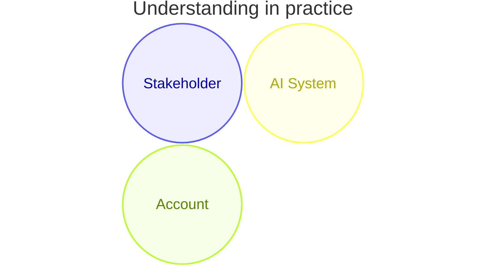

# Machine Understanding Revisited

This post continues the topic of [Machine Understanding I](./machine_understanding_1.md).

--------------------

## Recap

We discussed different views relating to whether modern computers can think:

- The Strong AI view, arguing that the [Turing test][turing] is a test for thinking and understanding (if they pass, they think).

- Intermediate views usually accept that the Turing test (and performance on tasks in general) isn't all that is needed to guarantee that a machine is thinking and understanding e.g.:
    - Arguing that symbol grounding isn't always needed (e.g. [David Chalmers][chalmers]);
    - Or that neural networks may think ([Could a Machine Think][churchlands]) if they form the right structures;
    - Arguing that symbol grounding _is_ needed (Harnad, [Koller and Bender][nlu]).
    - Mitchell has also interesting thoughts regarding [evaluation of models][melanie_talk_cognitive].

- On the other side, [Searle][searle_simple] claims that a machine doing only symbol manipulation can't learn meaning and consequently won't think nor understand.

## Paper

This post discusses a [recent article][mu] (Lombrozo et. al. 2026) proposing _accounts (or views) of understanding_. Research would benefit from stating _which view of understanding they subscribe to, before arguing for understanding_.

The article also captures what developers do in practice:

- Carrying out tests and performance benchmarks that test for out of distribution generalisation (or memorisation), transfer learning and so forth;
- Inspecting internal structures (say general ones, algorithms).
    - A question I personally find interesting is: _What kinds of programs do / can learning machines give rise to?_ Are they more like look-up tables? Or local rules and heuristics? Or maybe general algorithms? A mixture of all these? Or what are they? Eventually, this questions will be discussed in detail.

### Accounts of Understanding

In the paper [Machine Understanding][mu] (2026) they state:

> Assessing machine understanding requires answering questions of the form, "Does S understand T?", where S represents a system and T represents a target of understanding. For instance, in asking, "Do LLMs understand language?"

They consider the following (abriged) example: one predictive model consists on a _look-up table_; another on an _equation_ for an idealised situation (e.g. motion equation ignoring friction).

The tests show that look-up table is more accurate than the equation within the domain of evaluation.

However, the equation is a conceptual, general and compressed representation of this aspect of the phenomenon (which in their words "captures something about the data-generating process that is at best implicit in the look-up table.").

_Which "understands" better? The one with higher accuracy, or the one with more internal structure?_ They argue:

> The answer depends on one's account of understanding.

And later on say:

> (...) we take it as a guiding assumption that an account of understanding should offer some insight concerning what (if anything) is deficient about a look-up table or "mere retrieval" when it comes to understanding.

They then describe four different _accounts_ (or views) of a system's understanding of a task _T_ (two of these are "optional") and _a framework_ to specify the system _S_ which we won't discuss here.

A key idea in the paper is that _evidence of understanding_ should be framed within a particular notion of _what understanding is_.

An interesting aspect of the paper is the use of stories to illustrate the accounts, such as the one quoted at the start of this post.

Here is one of them, which summarises a large part of the paper:

> We can now consider a more encompassing example. Imagine four (hypothetical) scientists debating whether a given AI system understands anxiety. Dr. M's evidence comes from an analysis of internal representations: a decoding technique has revealed intermediate layers that correspond to key features of anxiety. Dr. A's evidence comes from performance: the system shows excellent performance on key benchmarks. Dr. E's evidence comes from the system's history: its training and interactions in the world. And Dr. P's evidence comes from phenomenology &mdash;an account of subjective experience and how the system does (or doesn’t) experience anxiety. (...) if that [the account of understanding] isn't made explicit and introduced into the debate, these scientists will simply talk past one another.

They also state:

> Our framework is consistent with a pluralist approach to machine understanding—one that recognizes multiple senses of understanding that can potentially diverge.

An another hypothetical example (informally shortened, bold is mine):

> When law students take the bar exam (...) the scores plausibly reflect not only relevant content knowledge, but also relevant experiences and abilities (a mix of model-, ability, and etiology based considerations). GPT-4 can now score within the top 10% on the bar exam (156), and could perform better soon. But this will not reflect any real-world legal experience, and it might not reflect the generalization ability that the test assesses in humans. Does it possess legal understanding?
>
> (...)
>
> **Making an inference** from some source of evidence (bar exam performance) to a claim about understanding **requires some account of understanding**. When that inferential step is spelled out, we can better assess whether it is justified.

Lastly, a very interesting idea in this article, is that the goals of stakeholders may help us define the system and required account of understanding (bold is mine):

> Which approach to understanding is most useful will depend on the goals of **stakeholders** and of a given **AI system** (see Table 1), and which **account** is adopted can have implications for whether machine understanding is a goal we ought to pursue.

We can summarise some of the above in a Venn diagram (the centre is the ideal area for a given case):

### Model and ability based accounts

Let's expand on two of the _accounts_:

- _Model-based_ (related to _intrinsic explanations_):
  > (...) understanding is a matter of what a system has "inside" – whether that's particular representations, algorithms, or other internal properties.
  >
  > (...)
  > A challenge for model-based accounts is defining which internal properties constitute understanding.

  _Decoding layers_, which is mentioned a few times in the paper, or computing _saliency maps_ and _feature importances_ are post hoc XAI methods. _Decoding a layer_ may also be considered a mechanistic interpretability method.

  Other relevant area is the design of interpretable and/or causal models, or at least the inclusion of some of such properties within models.

- _Ability-based_ (related to _extrinsic explanations_):
  > (...) understanding is constituted by its performance or range of behaviors, rather than the internal features that give rise to them.

The paper includes _etiology_ and _phenomenology_-based accounts usually are on top of ability and/or model-based accounts.

- Etiology-based accounts are related to the training process: models trained on specific datasets or ways may in principle be unable to develop certain structures, despite any claims for them.
- Phenomenology-based accounts are related to subjective experience. We won't discuss them further in this overview.

The accounts and related questions are arranged in the paper's table 1.

## Concluding remarks

In studies of explanation (including of AI systems) it is usually stated that explanations are always for an audience: the kind of explanation is dependent on those involved.

Explanations in AI may benefit from considering the participants/stakeholders, type of system, and account of understanding when producing the explanation (as shown in the Venn diagram given earlier).

[chalmers]: https://consc.net/papers/groundingdebate.pdf
[churchlands]: https://www.sciencedirect.com/science/chapter/edited-volume/abs/pii/B9780122154959500120
[melanie_talk_cognitive]: https://www.youtube.com/watch?v=yKbeCvOKvMchttps://www.cell.com/trends/cognitive-sciences/fulltext/S1364-6613(26)00077-X
[mu]: https://www.cell.com/trends/cognitive-sciences/fulltext/S1364-6613(26)00077-X
[nlu]: https://aclanthology.org/2020.acl-main.463/
[searle_simple]: https://www.beisecker.faculty.unlv.edu/Courses/PHIL%20330/Searle,%20Is%20the%20Brain's%20Mind%20a%20Computer%20Program.pdf
[turing]: https://academic.oup.com/mind/article/LIX/236/433/986238
