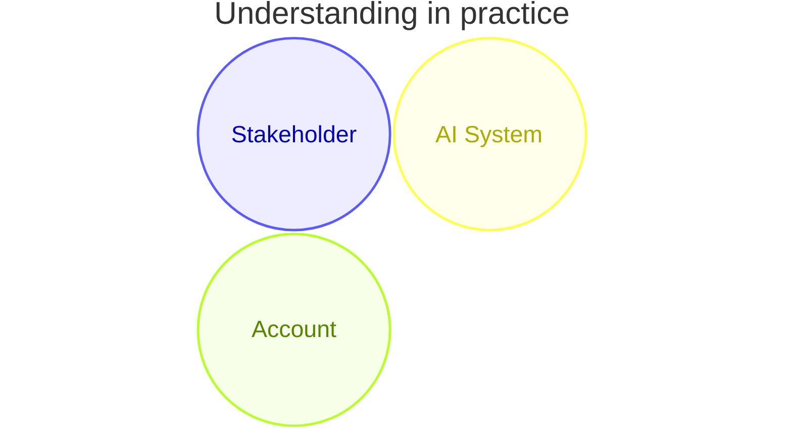

# Machine Understanding Revisited

This post continues the topic of [Machine Understanding I](./machine_understanding_1.md).

--------------------

## Recap

- The Strong AI view: argues that the [Turing test][turing] is a test for thinking and understanding (if they pass, they think).
- [Searle's view][searle_simple]: a machine doing only symbol manipulation can't learn meaning, and consequently won't think nor understand.
- Intermediate views usually add extra requirements:
    <!-- - Arguing that symbol grounding isn't always needed (e.g. [David Chalmers][chalmers]); -->
    - Forming the right internal structures,
    - Symbol grounding (Harnad, [Koller and Bender][nlu]),
    - Careful [evaluation of models][mm].

## Paper

<!-- We want to design machines that understand or to make sure they understand! Otherwise, they may fail and be harmful. So we need to think about understanding.
History of understanding? Examples of understanding? E.g. a mechanism on a real system, a simplified system, an analogy, a metaphor, a "fitting model", tinkering & programming, a person, a social situation; Types of systems & Types of explanations?
-->

A [recent article][mu] (Lombrozo et. al. 2026) considers that _understanding_ requires specifying a system and a task: Does System (_S_) understand task (_T_)?

But what is understanding? Rather than advocating for a view, the identify _four common views_ defining what understanding is from each perspective.

The paper uses examples to make the discussion more vivid and concrete. The one belows highlights the 4 accounts/views of understanding (bold is mine):

> Imagine four (hypothetical) scientists debating whether a given AI system understands anxiety. Dr M's evidence comes from **internal representations**: a decoding technique has revealed intermediate layers corresponding to key features of anxiety. Dr A's evidence comes from **performance**: the system shows excellent performance on key benchmarks. Dr E's evidence comes from the **system's history**: its training and interactions in the world. And Dr P's evidence comes from phenomenology&mdash;an account of **subjective experience** and how the system does (or does not) experience anxiety. Whose evidence should take precedence, especially when the scientists reach conflicting conclusions? The answer is that it depends on one's account of understanding, and if that is not made explicit and introduced into the debate, these scientists will simply talk past one another.

Lastly, they consider how the goals of stakeholders can help select an account of understanding for a system (bold is mine):

> Which approach to understanding is most useful will depend on the goals of **stakeholders** and of a given **AI system**, and which **account** is adopted can have implications for whether machine understanding is a goal we ought to pursue.

Let's now consider each account of understanding.

### Model-based accounts

Model-based accounts consider understanding to be:

> (...) a matter of what a system has "inside": particular representations, algorithms, or other internal properties.

<!-- and, -->
<!---->
<!-- > (...) taking some internal representation or world model to constitute understanding is the core of a model-based approach. -->

With a challenge of:

> (...) defining _which_ internal properties constitute understanding and establishing reliable methods for evaluating those properties.

As I read it, the evidence of internal structures can come from:

- Designing knowledge structures or decoding them (e.g. intrinsic XAI methods), these are _direct evidence_.
- Extrinsic XAI methods (_indirect evidence_). For example post-hoc methods (e.g. SHAP and LIME, Saliency Maps, Counterfactuals) _may_ suggest internal structures. Similarly reusing a layer for a different task (transfer learning) may be indirect evidence of internal representations. Frequently, these methods help a human build a model of the model (and don't provide evidence of internal model structure).
- Adequate Tests: some can provide indirect evidence of internal structure; they are direct evidence for ability-based accounts (see next section).

### Ability-based Account

_Ability-based_ accounts consider understanding to be:

> (...) constituted by its performance or behaviors, not the internal features that give rise to them.

This one is at the root related to Wittgenstein "meaning is use" and to the "Turing test". Both relate to how performance on a benchmark (if it benchmarks the right thing) could constitute understanding. But evaluations in AI are [not always well designed][mm] (nor carefully analysed or correctly interpreted).

In that light, they recall someone else's idea to improve evaluation of AI models:

> Buckner argues that future evaluations could instead draw inspiration from comparative psychology, adopting rigorous, species-fair testing protocols that assess underlying cognitive capacities rather than just surface-level performance [125].

Both ability-based understanding (via generalisatio tasks) or model-based understanding
 (via finding suitable representations) can often separate between systems that memorise versus others with more general concepts; that is, as long as the test is correctly designed, and the encoded representation can be found.

 These approaches can also be complementary, or disprove one another.

### Other accounts

The remaining two accounts are less central, but still complementary to ability or model-based accounts, and are briefly described next.

- Etiology-based accounts: is about the causal history of the system's development (e.g. in the learning process). Think of a model as a painting, and each stroke is an additional etiological datapoint; in the case of AIs, this is represented by the dataset (e.g. quality and diversity of data) and how it is used to learn from it (via training a model).
- Phenomenology-based accounts are related to subjective experience. We won't discuss them further in this overview.

>[!INFO]
> The accounts and questions to guide AI research are presented in the paper's Table 1, and seem useful.

<!-- Ability vs Model is the general view of defining an object by how it behaves/what it does vs how the parts interact (e.g. replace "it" by "matter"). It is possible that, by careful design of layers or architectures where each layer/part encodes a distinct concept.-->

## Concluding remarks

The four-accounts framework can help researchers frame relate challenges in the AI lifecycle. The paper makes this clear with one example and one abstract paragraph. The concrete example is (bold was added):

> Consider an ImageNet-trained system that classifies a picture as "class 949" [63]. What (if anything) does the system understand? On a **model-based** approach, one might use decoding techniques to identify which image features are associated with class 949. On an **ability-based** approach, one might assess classification performance: which images does the system classify as 949? On an **etiology-based** view, the place to look is the system’s history: What are the images used to train class 949 images of? (Strawberries.) What were human coders referring to when labeling these images? (Strawberries.)

And the abstracted view:

> (...) data and annotation bias (a largely etiological challenge), the black box problem (a largely model-based challenge; see Box 5), and OOD robustness (an ability-based challenge). However, they can be powerfully recast as specific concerns about the understanding a system does or does not possess.

_For machines_, we look at the coded or learnt program; _for humans_, we don't look at the brain. Hence, for humans, we only have different kinds of ability-based tests and can only ever _infer_ internal representations (or assume the human has access to it, and can describe it). Had we the have distinct practices (e.g. looking at the brain) then there would be more symmetry between humans and machine understanding.
<!-- (Incidentally the paper's title can be read as "How to understand machines" or "How machines understand". This may be in purpose, but I don't like it.) -->

In studies of explanation (including of AI systems) it is usually stated that explanations are always for an audience: the kind of explanation is dependent on those involved.

Explanations in AI may benefit from considering the participants/stakeholders, type of system, and account of understanding when producing the explanation (as shown in the Venn diagram given earlier).

[chalmers]: https://consc.net/papers/groundingdebate.pdf
<!-- [churchlands]: https://www.sciencedirect.com/science/chapter/edited-volume/abs/pii/B9780122154959500120 -->
[mm]: https://www.youtube.com/watch?v=yKbeCvOKvMchttps://www.cell.com/trends/cognitive-sciences/fulltext/S1364-6613(26)00077-X
[mu]: https://www.cell.com/trends/cognitive-sciences/fulltext/S1364-6613(26)00077-X
[nlu]: https://aclanthology.org/2020.acl-main.463/
[searle_simple]: https://www.beisecker.faculty.unlv.edu/Courses/PHIL%20330/Searle,%20Is%20the%20Brain's%20Mind%20a%20Computer%20Program.pdf
[turing]: https://academic.oup.com/mind/article/LIX/236/433/986238

<!-- - Carrying out tests and performance benchmarks that test for out of distribution generalisation (or memorisation), transfer learning and so forth; -->
<!-- - Inspecting internal structures (say general ones, algorithms). -->
<!--     - A question I personally find interesting is: _What kinds of programs do / can learning machines give rise to?_ Are they more like look-up tables? Or local rules and heuristics? Or maybe general algorithms? A mixture of all these? Or what are they? Eventually, this questions will be discussed in detail. -->
<!---->
